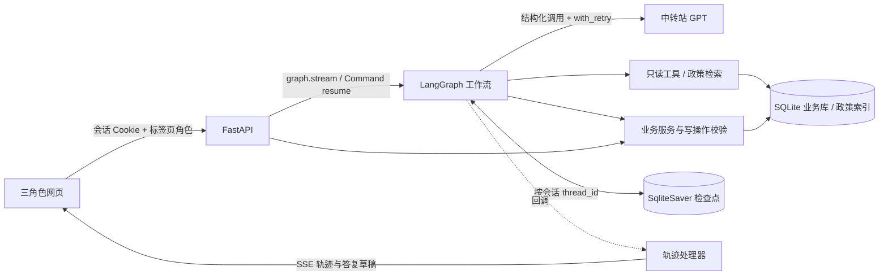
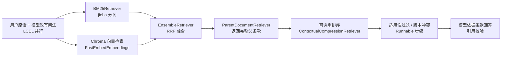

# 商品售后服务 Agent：项目方案

本文件说明项目定位、当前架构、目标架构和关键设计取舍。安装与使用见 [README.md](README.md)，演示数据与测试步骤见 [售后模拟测试指南](DEMO_TEST_GUIDE.md)。

文中标注“当前”的部分已经实现；标注“目标”的部分是后续计划。

## 1. 定位

一个面向 Agent 开发岗位的简历项目：用 LangGraph 编排、LangChain 连接模型与工具，实现从客户诉求、信息补全、政策依据、方案确认、人工审批到退货退款、换货、工单的完整售后流程，并提供可演示的三角色网页和可复现的评测入口。

项目重在技术实现的完整度与可讲解性：Agent 编排、RAG 检索、工具调用、人工介入、故障处理和评测。订单、物流、库存、仓库、退款和政策全部为虚构的模拟数据与接口，不接真实支付，也不追求生产级的数据规模、登录认证或多租户。

## 2. 功能与角色（当前）

| 角色 | 能做什么 |
| --- | --- |
| 客户 | 对话办理退货、换货、维修和转人工；政策咨询；查询订单、物流、案件、申请和工单；在对话卡片上选择商品与规格、确认或取消方案；登记寄回单号；执行或核对模拟退款 |
| 客服 | 审批绑定具体方案版本的退款；处理人工工单并答复客户；设置退款超时等演示故障 |
| 仓库 | 在作业看板上登记签收、检验、换新发货与送达 |

身份通过服务端会话映射，浏览器不能用任意用户编号访问他人数据。每个浏览器标签页保存自己的演示身份，三个角色可以同时在不同标签页操作。

## 3. 技术栈

| 层次 | 当前 | 目标 |
| --- | --- | --- |
| 环境 | 独立 uv 项目，`pyproject.toml`、`uv.lock`、`.venv` | 不变 |
| 后端 | Python、FastAPI、Pydantic | 不变 |
| 编排 | LangGraph 状态图；`SqliteSaver` 检查点按会话保存图状态；`interrupt` / `Command(resume)` 等待确认与审批；`graph.stream` 原生流式；回调处理器生成轨迹 | 只读查询环节改为 `create_agent` 子图（见工具调用） |
| 模型 | 中转站 GPT 系列（默认 `gpt-6.2-sol`），Responses 接口，配置来自本目录 `.env`；连接失败与上游 5xx 用 `.with_retry()` 重试一次 | 不变 |
| 业务存储 | SQLite | 不变 |
| 政策检索 | SQLite FTS5（中文双字切分）+ 适用性过滤 + 版本冲突检测 | `Document` + 文本切分器、`FastEmbedEmbeddings`（bge-small-zh）+ `Chroma`、jieba `BM25Retriever`、`EnsembleRetriever`、`ParentDocumentRetriever`、索引 API、可选重排序 |
| 工具调用 | 12 个只读查询均为 LangChain `@tool`（白名单 `tools/registry.py`），会话身份经运行配置注入；自然语言查询由 `create_agent` 子图在白名单内自主选择工具，`ModelCallLimitMiddleware` / `ToolCallLimitMiddleware` 限制调用次数；只读工具同时以 MCP 服务提供（stdio / Streamable HTTP），配置 `MCP_SERVER_URL` 后 Agent 经 `MultiServerMCPClient` 调用 | 不变 |
| 可观测 | `BaseCallbackHandler` 生成页面轨迹；可选本地 Arize Phoenix（`phoenix.otel.register` + `LangChainInstrumentor` 自动埋点，`.env` 开关，默认关闭） | 不变 |
| 页面 | FastAPI 提供静态 HTML/CSS/原生 JS 模块，无构建工程；SSE 流式事件 | 完善界面与排版设计，作为展示全部能力的主入口（见第 14 节） |
| 验证 | pytest 业务测试（本地）；`evals/replay.py` 离线/真实模型场景回放（13 个场景） | 检索评测与 RAG 方案对比 |

## 4. 架构

### 4.1 当前



检查点表与业务表位于同一个本地 SQLite 文件。客服审批写入后，由 API 恢复正在等待这份审批的客户会话。

### 4.2 一轮消息怎样处理（当前）

工作流节点：读取上下文 → 检查明确指令 → 准备上下文 → 识别诉求 → 选择并执行只读查询 → 检查缺失信息 → 规则校验 → 保存方案或补问 → 返回结果 → 判断是否等待（等待确认 / 等待审批 / 结束）。节点按职责放在 `workflow/nodes/` 下，明确指令与只读查询用映射表分派。

1. 从服务端会话取得身份；从检查点读取会话图状态，若会话所在案件已被其他会话或业务操作更新（案件进度 revision 变化）则改用案件进度中的最新草稿。
2. 页面按钮和明确指令（如“选择商品 ITEM-003”“确认换货”、带编号的确认/提交命令）直接路由，不调用模型。
3. 其余消息由模型做一次结构化提取（`IntakeUpdate`）：意图、订单、商品、数量、原因、拆封情况等，只提取本轮新增或更正的信息。
4. 自然语言的查询（订单、物流、申请、案件、工单）进入 `query_agent` 节点：`create_agent` 子图把识别出的编号与会话已知编号交给模型，由模型在只读工具白名单内选择工具，可并行调用多个；工具设为 `return_direct`，执行后即结束，答复由确定性代码按查询结果生成。页面按钮的固定指令与退货办理所需的订单查询仍走确定性路径。工具按会话身份校验归属。
5. 缺信息时只补问必要字段，并在回复卡片中给出可点击的候选；补问次数有上限，超过后转人工。
6. 规则服务根据订单事实和结构化政策计算资格、金额与审批要求，附上规则说明和所用条款；不再调用模型改写同一结论。
7. 政策咨询走检索 → 适用性过滤 → 冲突检测 → 模型依据条款回答，引用必须来自本轮检索结果。
8. 涉及写入时先展示方案：每轮结束前若有待确认的退货/换货方案，图在 `await_confirmation` 用 `interrupt` 暂停；当前申请待审批时在 `await_approval` 暂停。下一条消息或页面按钮以 `Command(resume=...)` 恢复，恢复值携带方案编号与版本，版本不一致且等待的版本仍有效时拒绝；客服审批写入后恢复客户会话。退货等待寄回、签收、检验事件后执行模拟退款。
9. 每轮回复附带结构化卡片；读取会话时附上方案与记录的当前状态。
10. 页面轨迹由回调处理器生成：节点、模型步骤（`model_step` 标签）、工具调用（`@tool` 与带 `tool_call` 标签的业务查询/写入）的开始与结束、耗时、token、参数摘要、政策引用、模型故障分类，以及暂停与恢复点；模型/工具调用次数和整轮时间在开始回调中检查，步骤数用 `recursion_limit`。
11. 流式接口消费 `graph.stream`：`messages` 模式中只提取 `PolicyAnswer.text` 作为答复草稿，轨迹快照随流推送；接口在后台线程中跑完整轮，浏览器断开不中断已开始的写入。

等待用户、等待审批、等待仓库事件和退款待核对都是持久化状态，请求结束即返回，不在后台循环调用模型。失败时会话检查点复位为一轮结束的状态；查询持续失败或预算耗尽转人工，写入结果未知时按原编号查询而不重复执行。

## 5. 关键设计取舍（当前）

| 问题 | 做法 | 原因 |
| --- | --- | --- |
| 模型能决定什么 | 只负责理解诉求和组织政策咨询答复；资格、金额、审批、状态和权限全部由确定性代码判断 | 金额与授权不能依赖模型输出；方便测试与解释 |
| 方案与授权 | 方案带版本；确认和审批绑定方案版本并有有效期；方案变化即失效 | 防止旧确认授权新金额 |
| 写操作 | 每个写操作有幂等键和操作记录；退款结果未知时只能核对原操作 | 避免重复退款和虚报成功 |
| 卡片与历史 | 卡片是当时快照，读取时附当前状态；失效卡片不提供按钮，后端仍拒绝旧版本 | 历史可追溯，同时不误导操作 |
| 模型故障 | 分为超时、连接失败、限流、上游错误、输出格式；超时 504、限流 429、其余 502；连接失败和上游 5xx 用 `.with_retry()` 重试一次 | 能从轨迹判断故障来源；超时重试会让等待翻倍 |
| 会话状态与业务事务 | 会话图状态由检查点保存；案件草稿同时写入案件进度表，与确认、提交、换货等业务写入同一事务；读取时以案件进度 revision 判断检查点是否过期 | 保留事务内的版本与冲突校验；检查点在业务提交后单独写入，崩溃时有案件的会话从案件进度恢复，无案件会话最多丢失最后一轮补充信息 |
| 查询由 Agent 选择工具 | 只读工具设为 `return_direct`，子图只调用一次模型（`ModelCallLimitMiddleware` 上限 1），工具最多 3 个；结果作为 artifact 交回工作流，按映射表生成答复，不采用模型自由文本；伪造参数被工具 schema 拒绝，超出上限时停止并说明；离线回放与测试用按同一规则选择的替身模型 | 展示 Agent 自主工具选择，同时把额外耗时控制在一次模型调用；同一回放场景单次实测，查询轮增加一次约 2 秒的模型调用与约 900 token，通过率不变 |
| interrupt 与授权 | `interrupt` 只负责持久化等待点和恢复；确认、审批的有效性仍由业务服务在写入事务中校验；等待点丢失时下一轮结束会重新建立 | 等待点不是授权来源，不会因检查点异常而放行或卡死 |
| 耗时 | 方案轮只调用一次模型；政策咨询两次 | 规则说明由代码给出；同一回放场景单次实测，方案轮从 28.2 秒降到 8.2 秒，token 减少约一半 |
| 多角色演示 | 按角色分别保存会话，请求头只选择已有会话，权限仍按会话用户校验 | 同一浏览器可并行演示三方，且不放宽权限 |
| 不可信文本 | 用户消息、检索正文和工具返回都作为数据处理，不作为指令 | 防止提示注入绕过确认与审批 |

## 6. 组件选型原则（目标）

项目尽量用 LangChain / LangGraph 的现成组件实现，原因有两个：一是这正是简历要展示的框架能力；二是这些组件都会触发 LangChain 回调，能被 OpenInference 自动埋点完整覆盖，无需手动埋点。只有订单、金额、审批、退款等业务规则和数据持久化保留为普通 Python 代码，它们作为图节点或工具运行，仍处在自动追踪的调用链中。

| 原自建实现 | 框架组件 | 阶段 | 状态 |
| --- | --- | --- | --- |
| 自建对话状态表保存图进度 | `SqliteSaver` 检查点（每会话一个 `thread_id`） | 2 | 当前 |
| 确认、审批等待靠业务状态判断后结束请求 | `interrupt` 暂停 + `Command(resume=...)` 恢复 | 2 | 当前 |
| 自建事件队列与 `emit` 回调推送进度 | `graph.stream(stream_mode=["messages", "updates", "custom"])` | 2 | 当前 |
| `Run.call` 手动包装每个节点、模型和工具调用以记录轨迹 | 自定义 `BaseCallbackHandler` 从回调生成页面轨迹；预算用 `recursion_limit` 与回调计数 | 2 | 当前 |
| 手写的连接失败重试循环 | `.with_retry(retry_if_exception_type=...)` | 2 | 当前 |
| 无外部追踪 | Phoenix + `LangChainInstrumentor` 自动埋点 | 3 | 当前 |
| 部分只读查询直接调用服务 | 全部改为 `@tool`，身份经运行配置注入 | 4 | 当前 |
| 按意图固定选择工具 | `create_agent` 子图 + `ToolCallLimitMiddleware` / `ModelCallLimitMiddleware` | 4 | 当前 |
| 无 | MCP Python SDK 服务 + `langchain-mcp-adapters` | 5 | 当前 |
| 自建 FTS5 索引与双字切分 | `Document`、`MarkdownHeaderTextSplitter`、`RecursiveCharacterTextSplitter`、jieba `BM25Retriever` | 8 | 目标 |
| 无向量检索 | `FastEmbedEmbeddings` + `Chroma` | 8 | 目标 |
| 手写内容哈希增量更新 | LangChain 索引 API（`index` + `SQLRecordManager`） | 8 | 目标 |
| 无 | `EnsembleRetriever`（RRF）、`ParentDocumentRetriever`、LCEL 并行多问法查询 | 8 | 目标 |
| 无 | `ContextualCompressionRetriever` + 本地交叉编码器 | 9 | 目标 |

阶段 2 的两处实现取舍：轨迹事件由回调处理器记录、在消费流的循环中推送，而不是在节点内调用 `get_stream_writer`（节点开始回调时取不到 writer）；流式接口保留一个后台线程，只用于浏览器断开后让本轮跑完。

保留为领域代码、但运行在图节点或 Runnable 中的部分：资格与金额计算、方案版本与授权、幂等写入与退款核对、政策适用性过滤与版本冲突检测、模型故障分类与中文提示。

## 7. 可观测性（当前）

- **页面轨迹：** 由回调处理器生成，脱敏后给用户查看，见第 4.2 节。
- **Phoenix：** 可选依赖组 `observability`。本地运行 Arize Phoenix，通过 `phoenix.otel.register`（OpenTelemetry 导出）与 `LangChainInstrumentor`（OpenInference 自动埋点）记录完整调用链；由 `.env` 开关控制，默认关闭；可配置隐藏模型输入输出。Phoenix 面向开发调试与评测，页面轨迹面向用户，两者并存。发送协议为标准 OTLP，以后可改接其他兼容平台。开启后页面轨迹面板提供 Phoenix 入口；服务关闭时推送剩余 span。
- **密钥与隐私：** 模型的 API 密钥以 `SecretStr` 保存，不进入 span；`PHOENIX_HIDE_IO=true` 时隐藏消息、输入输出、工具定义与检索文档原文。

## 8. Agent 工具调用与 MCP（当前）

- （当前）订单、物流、库存、政策检索、案件、退货申请、换货申请、工单等只读查询全部为 LangChain 工具；工具函数声明 `config: RunnableConfig`，由 LangChain 注入会话身份，不出现在参数 schema 中，缺少会话时拒绝查询。
- （当前）主图中的自然语言查询由 `create_agent` 构建的子图承担：模型在工具白名单内自行决定调用哪些工具，调用次数由中间件限制；轨迹记录模型选择的工具与参数。
- （当前）退款、创建申请、确认、审批、工单写入仍是确定性节点，不在 Agent 的工具列表中，模型无法调用。
- **MCP 服务：** `mcp_server.py` 用 MCP Python SDK（`FastMCP`）把只读工具白名单逐个注册为 MCP 工具，每个 MCP 工具直接调用同名 LangChain 工具，复用业务查询与身份校验，直接调用与经 MCP 调用结果一致。HTTP 方式无状态、JSON 响应，挂载在主服务 `/mcp/`，身份取请求头 `X-After-Sales-Session`；stdio 方式一个进程对应一个会话（`--session`）。缺少身份时以 `ToolError` 明确拒绝；只开放只读工具。
- **Agent 经 MCP：** 配置 `MCP_SERVER_URL` 后，Agent 的工具包装改为异步，经 `MultiServerMCPClient` 调用 MCP 工具；工具定义首次使用时加载并缓存，会话身份由工具拦截器（`tool_interceptors`）按每次调用写入请求头。Agent 可见的参数 schema 与直接调用相同，伪造参数同样被拒绝；工具名与结果不变，轨迹中标注“经 MCP”。查询子图以 `ainvoke` 运行在当前线程的事件循环中，不继承主图检查点。
- **失败处理：** MCP 服务不可达或调用失败时抛出 `MCPUnavailable`（HTTP 503）明确提示，本轮不保存、不改用本地工具，也不放宽身份校验；MCP 返回的查询错误作为工具失败交给 Agent，按“查询未成功”答复。
- **版本约束：** `langchain-mcp-adapters` 最新版（0.3.2）要求 `mcp<2`，因此 `mcp` 固定在 1.x，可选依赖中的 Phoenix 相应解析为兼容 `mcp` 1.x 的版本；适配器支持 `mcp` 2.x 后再一起升级。

## 9. 政策检索与 RAG（目标，阶段 6—9）

### 9.1 现状问题

当前检索按中文双字切分做全文匹配。口语化问题（如“几天内能退”“打开包装还能退吗”）直接检索时找不到任何条款，实际能用是因为识别诉求时模型先把问题改写成政策术语。检索效果因此完全依赖模型改写的措辞，偏差时直接转人工。政策只有 9 条短条款，也无法体现切分和召回的差异。

### 9.2 目标流程



| 环节 | 设计 |
| --- | --- |
| 语料 | 约 50—60 条带版本的结构化条款，加一份分章节的长篇政策文档和约 20 条常见问答，均为虚构 |
| 文档与切分 | 统一为 `Document`，元数据含条款编号、版本、适用商品、生效时间、来源位置；长文档先按标题切分，再控制块大小与重叠 |
| 向量化 | `FastEmbedEmbeddings` 本地运行 `BAAI/bge-small-zh-v1.5`（ONNX），不依赖中转站向量接口；默认测试使用替身向量 |
| 向量库 | `Chroma` 持久化到 `data/`，支持元数据过滤；选择它是因为 LangChain 集成成熟、过滤能力完整 |
| 增量索引 | LangChain 索引 API 按内容哈希只处理新增、修改与删除的文档 |
| 检索 | BM25 与向量两路由 `EnsembleRetriever` 按 RRF 融合；同时用用户原话与模型改写问法查询；小块命中后返回完整父条款 |
| 重排序 | 交叉编码器重排前若干候选，只在评测证明有收益时保留 |
| 生成 | 沿用“引用必须来自本轮检索”；无可靠依据时改写问法重查一次，仍无则说明并转人工 |
| 评测 | 约 50 题标注期望条款；指标为 Recall@3、Recall@5、MRR、无依据准确率、检索耗时、离线忠实度；对比仅关键词、仅向量、混合、混合 + 重排序 |

整条检索链封装为 `search_policy` 工具，供阶段 4 的 Agent 子图调用；每一路检索器的命中文档与得分都能在 Phoenix 中看到。

**边界：** 退货资格、金额和审批要求始终由规则服务读取结构化政策决定，不经过向量检索。检索只为政策咨询和解释提供证据，避免排名波动影响交易结果。

## 10. 可观测与评测

- **当前：** 回调处理器每轮生成运行轨迹（节点、模型与工具调用、参数摘要、结果、政策引用、耗时、token、重试次数、模型故障分类与首个数据耗时、暂停与恢复点），网页右侧可查看；服务端日志记录模型故障与慢调用，不含密钥和用户原文。
- **Phoenix（当前）：** 开发调试时查看完整调用链。
- **目标：** 检索评测在开启 Phoenix 时同时记录为实验。
- **评测入口：** `evals/replay.py` 提供离线（固定模型提取结果）与真实模型两种场景回放，目标增加检索评测模式。离线结果不能代表真实模型的理解能力。

## 11. 演示业务规则

以下为虚构规则，集中存放在规则数据中，不代表法律要求或真实商家政策。日期按业务时区 Asia/Hong_Kong 计算，签收日为第 0 日。

| 情境 | 规则 |
| --- | --- |
| 普通退货 | 已签收、未拆封；2026-10-01 及之后下单的订单签收后 7 个自然日内（之前下单为 5 日） |
| 质量原因 | 签收后 30 日内进入人工审核，不要求未拆封，不因普通退货超期被直接拒绝 |
| 审批门槛 | 预计退款超过 500 元需客服审批；质量原因无论金额都需审批 |
| 退款条件 | 申请与必要审批有效，仓库签收且检验通过后才能退款 |
| 部分退款 | 按商品项实付分摊到单位，最后一个可退单位吸收分币余数，累计不超过实付 |
| 运费 | 自动退款只含商品实付；运费争议转人工 |
| 换货 | 只做同款等价规格，不补差价；确认时预留库存，取消或检验未通过时释放 |
| 政策版本 | 按下单日期与商品选择版本；同等适用却冲突时转人工 |

政策扩充（开发计划阶段 6）后，以上规则继续由规则服务执行，新增条款主要用于咨询与检索评测。

## 12. 数据与接口边界

| 数据 | 主要内容 |
| --- | --- |
| 用户与会话 | 用户、角色、会话；按角色分别保存的会话 Cookie |
| 订单与商品项 | 归属、状态、签收日期、规格、数量、分摊实付、已退数量与金额 |
| 案件与对话 | 意图、已收集字段、方案版本、摘要；消息与附带卡片 |
| 方案、确认、审批 | 版本、金额、审批原因、有效期、失效原因 |
| 申请与事件 | 退货/换货申请、寄回/签收/检验/发货/送达事件 |
| 退款操作 | 幂等键、金额、结果与待核对标记 |
| 工单、物流、库存 | 交接证据与答复、模拟运输事件、可用与预留库存 |
| 运行轨迹 | 按会话保存的每轮轨迹 |

只读工具：`get_order`、`get_logistics`、`get_inventory`、`search_policy`，以及案件、申请、换货、工单查询。受控写操作：创建退货/换货申请、确认与取消方案、审批、退货与仓库事件、执行与核对退款、创建工单。页面和 Agent 的写入都经过同一套业务服务校验。

## 13. 代码布局

```text
after-sales-agent/
├── src/after_sales/
│   ├── api/          # 客户、客服、仓库、换货与页面接口
│   ├── agent/        # 模型连接与重试、诉求提取、政策解释、只读查询 Agent 与 MCP 客户端、上下文组装
│   ├── workflow/     # LangGraph 工作流
│   │   ├── graph.py      # 建图、检查点、流式运行、等待点恢复与失败处理
│   │   ├── nodes/        # 按职责划分的节点：路由与识别、只读查询、退货、换货/人工/政策、写操作、等待
│   │   ├── state.py      # 图状态与每轮运行上下文
│   │   ├── tracing.py    # 回调生成轨迹与调用预算
│   │   ├── preview.py    # 从 messages 流提取答复草稿
│   │   └── runtime.py    # 预算配置、错误类型、模型故障分类、轨迹摘要
│   ├── domain/       # 规则、金额、方案、申请、审批、退款、换货、工单、消息卡片
│   ├── tools/        # LangChain 只读工具、白名单与会话身份注入
│   ├── observability.py  # 可选的本地 Phoenix 追踪
│   ├── mcp_server.py     # 只读工具 MCP 服务（stdio / Streamable HTTP）
│   ├── retrieval/    # 政策加载、索引、检索与适用性过滤
│   └── storage/      # SQLite 表结构、种子数据与读写
├── web/              # 静态页面与原生 JS 模块
├── data/             # 本地业务库与政策索引（不提交）
├── tests/            # 业务测试（本地，不提交）
├── evals/            # 场景回放入口与样例
└── artifacts/        # 回放与评测的机器结果（不提交）
```

目标阶段预计新增：政策长文档与常见问答数据、检索链模块、检索评测样例；向量库与索引记录存放在 `data/`（不提交）。按任务实际创建，不提前搭空模块。

## 14. 前端展示（目标）

最终通过网页完整展示各项能力，而不只是作为调试入口。在功能阶段完成后统一完善界面与排版：
- 建立统一的视觉规范（配色、字号、间距、组件样式），三个角色页面风格一致，适配常见桌面与窄屏宽度；
- 客户对话页突出办理进度、方案卡片、政策引用与等待状态（等待确认、等待审批）；
- 运行轨迹面板直观呈现 LangGraph 节点流、模型与工具调用、暂停与恢复点；后续阶段的 Agent 工具选择、MCP 调用、检索命中与得分、Phoenix 调用链入口也在界面中可见；
- 提供面向演示的引导（示例诉求、角色切换、一键准备演示数据），便于按场景讲解。
