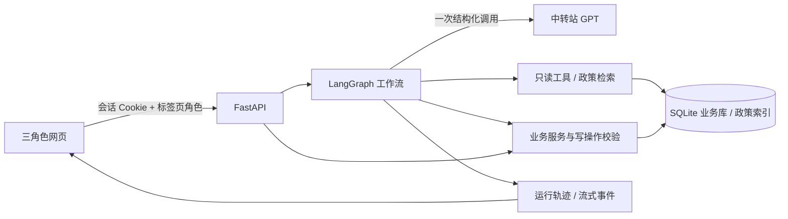
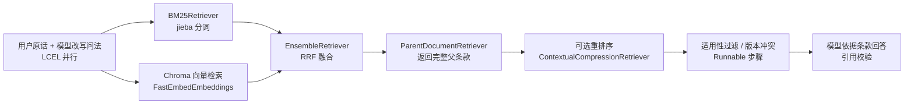

# 商品售后服务 Agent：项目方案

本文件说明项目定位、当前架构、目标架构和关键设计取舍。安装与使用见 [README.md](README.md)，演示数据与测试步骤见 [售后模拟测试指南](DEMO_TEST_GUIDE.md)，任务与完成标准见 [DEVELOPMENT_PLAN.md](DEVELOPMENT_PLAN.md)，约束见 [PROJECT_RULES.md](PROJECT_RULES.md)。

文中标注“当前”的部分已经实现；标注“目标”的部分是计划，以开发计划的勾选状态为准。

## 1. 定位

一个面向 Agent 开发岗位的简历项目：用 LangGraph 编排、LangChain 连接模型与工具，实现从客户诉求、信息补全、政策依据、方案确认、人工审批到退货退款、换货、工单的完整售后流程，并提供可演示的三角色网页和可复现的评测入口。

项目重在技术实现的完整度与可讲解性：Agent 编排、RAG 检索、工具调用、人工介入、故障处理和评测。订单、物流、库存、仓库、退款和政策全部为虚构的模拟数据与接口，不接真实支付，也不追求生产级的数据规模、登录认证或多租户。

## 2. 功能与角色（当前）

| 角色 | 能做什么 |
| --- | --- |
| 客户 | 对话办理退货、换货、维修和转人工；政策咨询；查询订单、物流、案件、申请和工单；在对话卡片上选择商品与规格、确认或取消方案；登记寄回单号；执行或核对模拟退款 |
| 客服 | 审批绑定具体方案版本的退款；处理人工工单并答复客户；设置退款超时等演示故障 |
| 仓库 | 在作业看板上登记签收、检验、换新发货与送达 |

身份通过服务端会话映射，浏览器不能用任意用户编号访问他人数据。每个浏览器标签页保存自己的演示身份，三个角色可以同时在不同标签页操作。

## 3. 技术栈

| 层次 | 当前 | 目标 |
| --- | --- | --- |
| 环境 | 独立 uv 项目，`pyproject.toml`、`uv.lock`、`.venv` | 不变 |
| 后端 | Python、FastAPI、Pydantic | 不变 |
| 编排 | LangGraph 状态图；自建对话状态表、事件队列和调用包装 | `SqliteSaver` 检查点、`interrupt` / `Command(resume)`、原生 `stream` 模式、回调生成轨迹 |
| 模型 | 中转站 GPT 系列，Responses 接口，配置来自本目录 `.env` | 重试用 `.with_retry()`；版本同步待用户确认 |
| 业务存储 | SQLite | 不变 |
| 政策检索 | SQLite FTS5（中文双字切分）+ 适用性过滤 + 版本冲突检测 | `Document` + 文本切分器、`FastEmbedEmbeddings`（bge-small-zh）+ `Chroma`、jieba `BM25Retriever`、`EnsembleRetriever`、`ParentDocumentRetriever`、索引 API、可选重排序 |
| 工具调用 | 代码按意图固定选择只读工具 | `create_agent` 子图 + 调用上限中间件自主选择只读工具；只读工具同时以 MCP 服务提供 |
| 可观测 | 自建运行轨迹 | 自建页面轨迹 + 本地 Arize Phoenix（OpenTelemetry + OpenInference 自动埋点） |
| 页面 | FastAPI 提供静态 HTML/CSS/原生 JS 模块，无构建工程；流式事件 | 不变 |
| 验证 | `tests/` 业务测试；`evals/replay.py` 场景回放 | pytest 统一入口；检索评测与 RAG 方案对比 |

## 4. 架构

### 4.1 当前



### 4.2 一轮消息怎样处理（当前）

工作流节点：读取案件 → 检查明确指令 → 准备上下文 → 识别诉求 → 选择并执行只读查询 → 检查缺失信息 → 规则校验 → 保存方案或补问 → 返回结果。

1. 从服务端会话取得身份，读取当前案件与对话状态。
2. 页面按钮和明确指令（如“选择商品 ITEM-003”“确认换货”、带编号的确认/提交命令）直接路由，不调用模型。
3. 其余消息由模型做一次结构化提取（`IntakeUpdate`）：意图、订单、商品、数量、原因、拆封情况等，只提取本轮新增或更正的信息。
4. 代码按意图选择只读工具（订单、物流、库存、案件、申请、工单、政策检索），按归属校验返回数据。
5. 缺信息时只补问必要字段，并在回复卡片中给出可点击的候选；补问次数有上限，超过后转人工。
6. 规则服务根据订单事实和结构化政策计算资格、金额与审批要求，附上规则说明和所用条款；不再调用模型改写同一结论。
7. 政策咨询走检索 → 适用性过滤 → 冲突检测 → 模型依据条款回答，引用必须来自本轮检索结果。
8. 涉及写入时先展示方案，等待用户确认；需要审批时等待客服；退货等待寄回、签收、检验事件后执行模拟退款。
9. 每轮回复附带结构化卡片；读取会话时附上方案与记录的当前状态。

等待用户、等待审批、等待仓库事件和退款待核对都是持久化状态，请求结束即返回，不在后台循环调用模型。

## 5. 关键设计取舍（当前）

| 问题 | 做法 | 原因 |
| --- | --- | --- |
| 模型能决定什么 | 只负责理解诉求和组织政策咨询答复；资格、金额、审批、状态和权限全部由确定性代码判断 | 金额与授权不能依赖模型输出；方便测试与解释 |
| 方案与授权 | 方案带版本；确认和审批绑定方案版本并有有效期；方案变化即失效 | 防止旧确认授权新金额 |
| 写操作 | 每个写操作有幂等键和操作记录；退款结果未知时只能核对原操作 | 避免重复退款和虚报成功 |
| 卡片与历史 | 卡片是当时快照，读取时附当前状态；失效卡片不提供按钮，后端仍拒绝旧版本 | 历史可追溯，同时不误导操作 |
| 模型故障 | 分为超时、连接失败、限流、上游错误、输出格式；超时 504、限流 429、其余 502；仅连接失败和 5xx 且未收到数据时重试一次 | 能从轨迹判断故障来源；超时重试会让等待翻倍 |
| 耗时 | 方案轮只调用一次模型；政策咨询两次 | 规则说明由代码给出；同一回放场景单次实测，方案轮从 28.2 秒降到 8.2 秒，token 减少约一半 |
| 多角色演示 | 按角色分别保存会话，请求头只选择已有会话，权限仍按会话用户校验 | 同一浏览器可并行演示三方，且不放宽权限 |
| 不可信文本 | 用户消息、检索正文和工具返回都作为数据处理，不作为指令 | 防止提示注入绕过确认与审批 |

## 6. 组件选型原则（目标）

项目尽量用 LangChain / LangGraph 的现成组件实现，原因有两个：一是这正是简历要展示的框架能力；二是这些组件都会触发 LangChain 回调，能被 OpenInference 自动埋点完整覆盖，无需手动埋点。只有订单、金额、审批、退款等业务规则和数据持久化保留为普通 Python 代码，它们作为图节点或工具运行，仍处在自动追踪的调用链中。

| 现在的自建实现 | 目标组件 | 阶段 |
| --- | --- | --- |
| 自建对话状态表保存图进度 | `SqliteSaver` 检查点（每会话一个 `thread_id`） | 2 |
| 确认、审批等待靠业务状态判断后结束请求 | `interrupt` 暂停 + `Command(resume=...)` 恢复 | 2 |
| 自建事件队列与 `emit` 回调推送进度 | `graph.stream(stream_mode=["updates", "messages", "custom"])` + `get_stream_writer` | 2 |
| `Run.call` 手动包装每个节点、模型和工具调用以记录轨迹 | 自定义 `BaseCallbackHandler` 从回调生成页面轨迹；预算用 `recursion_limit` | 2 |
| 手写的连接失败重试循环 | `.with_retry(retry_if_exception_type=...)` | 2 |
| 无外部追踪 | Phoenix + `LangChainInstrumentor` 自动埋点 | 3 |
| 部分只读查询直接调用服务 | 全部改为 `@tool`，身份经运行配置注入 | 4 |
| 按意图固定选择工具 | `create_agent` 子图 + `ToolCallLimitMiddleware` / `ModelCallLimitMiddleware` | 4 |
| 无 | MCP Python SDK 服务 + `langchain-mcp-adapters` | 5 |
| 自建 FTS5 索引与双字切分 | `Document`、`MarkdownHeaderTextSplitter`、`RecursiveCharacterTextSplitter`、jieba `BM25Retriever` | 8 |
| 无向量检索 | `FastEmbedEmbeddings` + `Chroma` | 8 |
| 手写内容哈希增量更新 | LangChain 索引 API（`index` + `SQLRecordManager`） | 8 |
| 无 | `EnsembleRetriever`（RRF）、`ParentDocumentRetriever`、LCEL 并行多问法查询 | 8 |
| 无 | `ContextualCompressionRetriever` + 本地交叉编码器 | 9 |

保留为领域代码、但运行在图节点或 Runnable 中的部分：资格与金额计算、方案版本与授权、幂等写入与退款核对、政策适用性过滤与版本冲突检测、模型故障分类与中文提示。

## 7. LangGraph 原生化与可观测性（目标，阶段 2—3）

- **检查点：** `SqliteSaver` 保存图状态，服务重启后按会话的 `thread_id` 继续；业务表仍是订单、方案、申请、退款的权威来源。
- **人工介入：** 方案确认与客服审批节点调用 `interrupt` 暂停；页面按钮或客服操作以 `Command(resume=...)` 恢复，恢复值携带方案编号与版本，方案变化后旧的恢复指令被拒绝。
- **流式输出：** 页面进度与答复草稿来自 LangGraph 原生 `stream` 模式和 `get_stream_writer`，不再维护自建事件队列。
- **页面轨迹：** 由自定义回调处理器从节点、模型、工具的开始/结束事件生成，字段与现在一致（耗时、token、参数与结果摘要、政策引用、模型故障分类），继续做脱敏，供用户查看。
- **Phoenix：** 本地运行 Arize Phoenix，通过 `phoenix.otel.register`（OpenTelemetry 导出）与 `LangChainInstrumentor`（OpenInference 自动埋点）记录完整调用链；由 `.env` 开关控制，默认关闭；可配置隐藏模型输入输出。Phoenix 面向开发调试与评测，页面轨迹面向用户，两者并存。发送协议为标准 OTLP，以后可改接其他兼容平台。

## 8. Agent 工具调用与 MCP（目标，阶段 4—5）

- 订单、物流、库存、政策检索、案件、退货申请、换货申请、工单等只读查询全部为 LangChain 工具；会话身份通过运行配置注入，不是模型可填写的参数。
- 主图中的只读查询环节由 `create_agent` 构建的子图承担：模型在工具白名单内自行决定调用哪些、调用几次，调用次数由中间件限制。
- 退款、创建申请、确认、审批、工单写入仍是确定性节点，模型无法调用。
- 只读工具以 MCP 服务（stdio 与 HTTP）提供，复用相同的业务查询与身份校验；Agent 用 `MultiServerMCPClient` 加载 MCP 工具，直接调用与经 MCP 调用结果一致。

## 9. 政策检索与 RAG（目标，阶段 6—9）

### 9.1 现状问题

当前检索按中文双字切分做全文匹配。口语化问题（如“几天内能退”“打开包装还能退吗”）直接检索时找不到任何条款，实际能用是因为识别诉求时模型先把问题改写成政策术语。检索效果因此完全依赖模型改写的措辞，偏差时直接转人工。政策只有 9 条短条款，也无法体现切分和召回的差异。

### 9.2 目标流程



| 环节 | 设计 |
| --- | --- |
| 语料 | 约 50—60 条带版本的结构化条款，加一份分章节的长篇政策文档和约 20 条常见问答，均为虚构 |
| 文档与切分 | 统一为 `Document`，元数据含条款编号、版本、适用商品、生效时间、来源位置；长文档先按标题切分，再控制块大小与重叠 |
| 向量化 | `FastEmbedEmbeddings` 本地运行 `BAAI/bge-small-zh-v1.5`（ONNX），不依赖中转站向量接口；默认测试使用替身向量 |
| 向量库 | `Chroma` 持久化到 `data/`，支持元数据过滤；选择它是因为 LangChain 集成成熟、过滤能力完整 |
| 增量索引 | LangChain 索引 API 按内容哈希只处理新增、修改与删除的文档 |
| 检索 | BM25 与向量两路由 `EnsembleRetriever` 按 RRF 融合；同时用用户原话与模型改写问法查询；小块命中后返回完整父条款 |
| 重排序 | 交叉编码器重排前若干候选，只在评测证明有收益时保留 |
| 生成 | 沿用“引用必须来自本轮检索”；无可靠依据时改写问法重查一次，仍无则说明并转人工 |
| 评测 | 约 50 题标注期望条款；指标为 Recall@3、Recall@5、MRR、无依据准确率、检索耗时、离线忠实度；对比仅关键词、仅向量、混合、混合 + 重排序 |

整条检索链封装为 `search_policy` 工具，供阶段 4 的 Agent 子图调用；每一路检索器的命中文档与得分都能在 Phoenix 中看到。

**边界：** 退货资格、金额和审批要求始终由规则服务读取结构化政策决定，不经过向量检索。检索只为政策咨询和解释提供证据，避免排名波动影响交易结果。

## 10. 可观测与评测

- **当前：** 每轮保存运行轨迹（节点、模型与工具调用、参数摘要、结果、政策引用、耗时、token、模型故障分类与首个数据耗时），网页右侧可查看；服务端日志记录模型故障与慢调用，不含密钥和用户原文。
- **目标：** 页面轨迹改由回调生成；开发调试与评测使用本地 Phoenix；检索评测在开启 Phoenix 时同时记录为实验。
- **评测入口：** `evals/replay.py` 提供离线（固定模型提取结果）与真实模型两种场景回放，目标增加检索评测模式。离线结果不能代表真实模型的理解能力。

## 11. 演示业务规则

以下为虚构规则，集中存放在规则数据中，不代表法律要求或真实商家政策。日期按业务时区 Asia/Hong_Kong 计算，签收日为第 0 日。

| 情境 | 规则 |
| --- | --- |
| 普通退货 | 已签收、未拆封；2026-10-01 及之后下单的订单签收后 7 个自然日内（之前下单为 5 日） |
| 质量原因 | 签收后 30 日内进入人工审核，不要求未拆封，不因普通退货超期被直接拒绝 |
| 审批门槛 | 预计退款超过 500 元需客服审批；质量原因无论金额都需审批 |
| 退款条件 | 申请与必要审批有效，仓库签收且检验通过后才能退款 |
| 部分退款 | 按商品项实付分摊到单位，最后一个可退单位吸收分币余数，累计不超过实付 |
| 运费 | 自动退款只含商品实付；运费争议转人工 |
| 换货 | 只做同款等价规格，不补差价；确认时预留库存，取消或检验未通过时释放 |
| 政策版本 | 按下单日期与商品选择版本；同等适用却冲突时转人工 |

政策扩充（开发计划阶段 6）后，以上规则继续由规则服务执行，新增条款主要用于咨询与检索评测。

## 12. 数据与接口边界

| 数据 | 主要内容 |
| --- | --- |
| 用户与会话 | 用户、角色、会话；按角色分别保存的会话 Cookie |
| 订单与商品项 | 归属、状态、签收日期、规格、数量、分摊实付、已退数量与金额 |
| 案件与对话 | 意图、已收集字段、方案版本、摘要；消息与附带卡片 |
| 方案、确认、审批 | 版本、金额、审批原因、有效期、失效原因 |
| 申请与事件 | 退货/换货申请、寄回/签收/检验/发货/送达事件 |
| 退款操作 | 幂等键、金额、结果与待核对标记 |
| 工单、物流、库存 | 交接证据与答复、模拟运输事件、可用与预留库存 |
| 运行轨迹 | 按会话保存的每轮轨迹 |

只读工具：`get_order`、`get_logistics`、`get_inventory`、`search_policy`，以及案件、申请、换货、工单查询。受控写操作：创建退货/换货申请、确认与取消方案、审批、退货与仓库事件、执行与核对退款、创建工单。页面和 Agent 的写入都经过同一套业务服务校验。

## 13. 代码布局

```text
after-sales-agent/
├── src/after_sales/
│   ├── api/          # 客户、客服、仓库、换货与页面接口
│   ├── agent/        # 模型连接、诉求提取、政策解释、上下文组装
│   ├── workflow/     # LangGraph 工作流、调用预算、模型调用与故障分类、轨迹
│   ├── domain/       # 规则、金额、方案、申请、审批、退款、换货、工单、消息卡片
│   ├── tools/        # LangChain 只读工具
│   ├── retrieval/    # 政策加载、索引、检索与适用性过滤
│   └── storage/      # SQLite 表结构、种子数据与读写
├── web/              # 静态页面与原生 JS 模块
├── data/             # 本地业务库与政策索引（不提交）
├── tests/            # 业务测试
├── evals/            # 场景回放入口与样例
└── artifacts/        # 回放与评测的机器结果（不提交）
```

目标阶段预计新增：工作流节点模块、轨迹回调处理器、Phoenix 开关与初始化、MCP 服务入口、政策长文档与常见问答数据、检索链模块、检索评测样例；向量库与索引记录存放在 `data/`（不提交）。按任务实际创建，不提前搭空模块。
